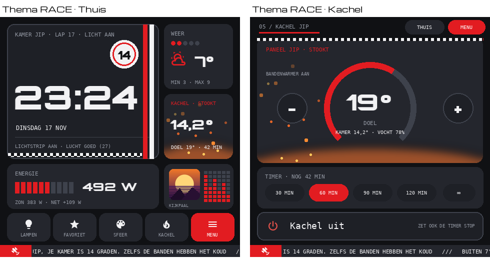

# ROBOBOOZ

Retro thema voor **Guition ESP32-S3-4848S040** (4", 480×480) touch displays met ESPHome + LVGL, gekoppeld aan Home Assistant en Music Assistant.

Ontwerp en idee: **Jeroen van Sonsbeek**

## Displays

| Bestand | Ruimte | Bijzonderheden |
|---|---|---|
| `display-woonkamer.yaml` | Woonkamer | TV-pagina, kachel-animatie, lampen woonkamer/keuken/eettafel, speler Yamaha woonkamer |
| `display-studio.yaml` | Studio | ON AIR, PC-pagina (Studio aan/uit), lampen studio/zolder/burolamp, speler Studio mini |
| `display-jip.yaml` | Slaapkamer Jip | RACE-thema met finishvlag, Kachel-pagina (paneel aan met timerkeuze 15/30/60 min, uit met één tik, kamertemperatuur en gewenste temperatuur instellen, vonkjes/vlokjes op de kamertegel), NIET STOREN, **Wekker** (knop op Thuis; RACE-stijl, afgaan-scherm met SLUIMER -/+ en STOP, wekkerregel in de nachtstand), nieuw paneel met 1 relais (aanraakcalibratie 0..479), intercom naar de kijkpaal, speler kijkpaal |
| `display-slaapkamer.yaml` | Slaapkamer Maartje en Jeroen | **Nieuwe stijl "Raster & Cirkel"** (v0.27): papierwit, Inter Tight + IBM Plex Mono, cirkels in vermiljoen en ultramarijn; op Thuis staan de cirkel en de kwartcirkel elk kwartier ergens anders. **Avondstand** = donker kleurenschema "warm donker" (vanzelf 20:00–09:00, of met de hand in LICHT). Schuif **FELHEID SCHERM** in LICHT; in het donkere schema is dat ook de nachthelderheid. Thuis (met LICHT UIT en BEDTIJD (2 s vasthouden): lampen badkamer, hal, toilet, overlopen, studio en slaapkamer uit, tv en Yamaha uit, alleen de e-deken-smartplug uit, thermostaat 15 °C via `script.bedtijd`), Licht, Sfeer, Nu speelt (met hoes), **Favorieten** (radio en playlists uit Music Assistant), **Deurbel** (camerabeeld voordeur bij aanbellen; zelf geopend start het display kort een livestream via `eufy_security.start_p2p_livestream`), **Goedemorgen** (na de wekker: tijd, buiten, afspraken van vandaag), Kamer, Weer, **Wekker** (+ wekkergeluid; afgaan-scherm met tijd, SLUIMER -/+ en STOP; volume 20% → 50% → 80%, Alarm 60% en na 1 minuut knipperende lampen) en Menu. Spelerbalk bovenin, onderbalk met **LICHT** (lampen aan/gedimd/uit, scherm normaal/nachtstand/slapen, avondstand). Tikken: slapen → nachtstand (klok + wekkertijd) → normaal; 's nachts (21–6) na 1 min vanzelf slapen, donker schema en gedimd. Toont "geen verbinding met HA" als HA weg is. Paneel met 1 relais (aanraakcalibratie 0..479); relais niet ingesteld |

## Functies

- Thuisscherm met klok, datum en NOS-nieuws (3 regels), live ticker, weer, energie (incl. energiekosten vandaag en ZON/NET live) en nu-speelt met VU-meter
- Klik op de klok: alle lampen aan/uit
- Favorieten: alle favoriete radiozenders (links) en playlists (rechts) uit Music Assistant, meest gespeeld bovenaan, scrollbaar, met albumart en volumeslider van de eigen speler
- Nu speelt-popup en wachtrij
- Lampen, Sfeer (scènes + Alles uit / Random kleuren), Klimaat, Huis, Energie, Schakelaars
- 8 thema's (A–D, NEC, Oranje, NMHC, Disco) met automatisch wedstrijdthema; display Jip heeft RACE in plaats van Disco en kiest zijn thema zelf
- Menu met kaarten, ook Nachtstand (dimme klok met sterren)
- Dimmen: 1 min → 65 %, 2 min → 35 %, 30 min → nachtstand; eerste tik maakt alleen wakker
- Automatische nachtstand tussen 23:00 en 06:00, behalve als er muziek speelt of er nog lampen aan zijn
- Alle displays: pagina Home Assistant (services als modules, CPU/geheugen/schijf-meters, temperatuur, 24-uursgrafiek, terminal)
- Weerpagina (alle displays): regen voor de komende 2 uur (12 balkjes van 10 minuten, Buienradar) met het weericoon van nu als watermerk (doorzichtig, achter de balkjes)
- Alle displays: op Energie opent de tegel *Bespaard door zon vandaag* de pagina Zonnestroom (live zon / huis / net met lopende bolletjes, 'goed moment om te wassen')
- Woonkamer: op de weerpagina ook een paneel voor de zonwering eettafel: OMHOOG / STOP / OMLAAG, de stand in blokjes en een venstertje waarin het doek meebeweegt, met de batterij erin; woorden onder de knoppen en 'BATTERIJ LAADT OP' / 'BIJNA LEEG' in de standregel
- Woonkamer: pagina Plantenkas (4 planten; de pot is de vochtmeter, met status TOP / TE NAT / DORST, temperatuur en batterij)
- Studio: geheime Intercom naar parallelle universums (tik op het satellietblok in de LIVE-balk): kanaalkiezer met 12 kanalen (o.a. 9 Wekkerbrigade, 10 Keukenkazerne, 11 Shampoo-Commando, 12 Fluisterwekker), PUSH TO TALK, ruis + bericht via ElevenLabs als aankondiging op de studiospeaker (`script.intercom_zend`, `input_text.intercom_log`; geluiden in `www/robobooz/`, kanaal 12 begint met een zacht melodietje `intro_12.mp3`)
- Alle intercomschermen: kies de ontvanger (HIER of een andere kamer); PUSH TO TALK stuurt het kanaal van de draaischijf daarheen (`script.intercom_zend`, veld `naar`), het telefoonvak een oproep van Jeroen (`script.intercom_bel`). Berichten klinken op hetzelfde volume als de muziek op die speler
- Woonkamer: dezelfde Intercom, maar alleen bereikbaar als woonkamer, woonkamer totaal of eettafel speelt of klaar staat (dan toont het LIVE-blok een satelliet); het bericht gaat naar de speler die speelt
- Jip: muziek alleen van de kijkpaal (Music Assistant kent hem twee keer; beide spelers worden gevolgd); speelt de kijkpaal, dan na 30 s niets aanraken automatisch Nu speelt (een slapend scherm blijft tussen 23:00 en 07:00 uit), en 30 s na het stoppen terug naar Thuis
- Jip: Wekker (knop op Thuis, met de wekkertijd als hij aan staat): tijd -/+ per uur en per 5 min, AAN/UIT, Werkdagen / Elke dag / Weekend, geluid kiezen, LICHT MEE (zonsopgang) en PROBEER NU. Gaat hij af: afgaan-scherm met de tijd, SLUIMER (-/+ per 5 min, standaard 5) en STOP, ook vanuit nachtstand en NIET STOREN; het scherm wisselt en dimt dan niet. In de nachtstand gedimd "Wekker gaat 07:00" of "Sluimert tot 07:05". Geluid op de kijkpaal
- Jip: Kachel-pagina voor `climate.paneel_jip` (`script.paneel_jip_timer_starten`, `script.paneel_jip_uit`, `binary_sensor.paneel_jip_aan`, `sensor.paneel_jip_resterend`), NIET STOREN (`input_boolean.jip_niet_storen`), intercom op de kijkpaal (`script.intercom_zend` met `speler`)
- Radio: bij reclame ('Advert') een eigen hoes "Commercial Break" (zet `www/robobooz/` uit deze repo in `/config/www/robobooz/`)
- LIVE-ticker: AI-roast plus bijzonderheden van server (service uit, CPU heet/druk) en planten (dorst, te koud/warm, batterij bijna leeg)

## Installeren

1. Zet de bestanden in je ESPHome-configmap (HA: `/config/esphome/`), inclusief de mappen `display/` en `components/`.
   `components/robobooz_build` is een klein lokaal component dat een compileroptie aanzet; zonder die optie faalt het linken van deze grote configuratie (`l32r: literal target out of range`).
2. Kopieer `secrets.example.yaml` naar `secrets.yaml` en vul je waarden in (wifi, de adressen van HA en Music Assistant (`ha_url`, `ma_url`), Music Assistant-token, API-/OTA-sleutels en de namen + `person.`-entiteiten van de huisgenoten).
3. De afbeeldingen in `display/` staan al in deze repo. `oranje.jpg` wordt lokaal gelezen; de kachelanimaties `vuur12.gif` en `sneeuw12.gif` (12 frames) haalt de build van GitHub. `vuur.gif` en `sneeuw.gif` zijn de oude, grote versies en worden niet meer gebruikt.
4. Installeer via ESPHome Device Builder (draadloos). Bouw één display tegelijk: het compileren vraagt ~2,5 GB RAM.
5. Een nieuw paneel de eerste keer via USB flashen ("Aansluiten op deze computer"); daarna kan het draadloos.

### ESPHome-versie en geheugen

- Getest met ESPHome **2026.11.0** (ESP-IDF 5.5.6).
- Alle displays hebben `esp32 > framework > advanced > loop_task_stack_size: 16384`. Met de standaard 8 KB liep de hoofdtaak bij het opstarten over (alle pagina's worden in één keer aangemaakt, ~8,5 KB nodig): crash 'Abort' op core 1 en een OTA-rollback.
- Diagnose in HA per display: *Stapel hoofdtaak vrij* (moet ruim boven ~5000 B blijven) en *Intern RAM vrij* (woonkamer is het krapst, ~25 kB; onder ~15 kB gaan https-hoesjes mis).
- Zuinig: themacontrole elke 5 s, Music Assistant elke 3 s als er muziek speelt of een muziekpagina open is, anders elke 12 s.

### Nodig in Home Assistant

Zet bij elk display in HA de ESPHome-integratie op *Configureren → "Sta het apparaat toe Home Assistant-acties uit te voeren"*.

**Alle displays**
- Music Assistant (app) op `http://<ha-ip>:8095` met API-token (`ma_api_token`); favorieten en spelers worden rechtstreeks uit Music Assistant gehaald
- Thema en teksten: `input_select.display_thema` (A–H), `input_text.nieuws_display` (NOS-feed), `input_text.display_roast`, `input_text.intercom_log`
- Weer: `weather.de_scholekster`, `input_text.weer_uren_display`, `input_text.weer_dagen_display`, `sensor.neerslag_buienradar_regen_data` (Neerslag-app, attribuut `data`)
- Goedemorgen: `input_text.ochtend_info_display`, `input_text.ochtend_agenda_display`
- Energie: `sensor.energiekosten_vandaag` / `_maand`, `sensor.stroomkosten_*`, `sensor.gaskosten_*`, `sensor.waterkosten_*`, `sensor.zonnepanelen_bespaard_vandaag`, `sensor.huisverbruik_nu`, `sensor.dle3a27053_generated_energy_today`
- Zonnestroom en ZON/NET op Thuis: `sensor.dle3a27053_pv_output_actual` (omvormer) en `sensor.p1_meter_3c39e7240afe_active_power` (P1)
- Server (pagina Home Assistant): `input_text.server_info_display`, `input_text.server_hist_cpu`, `input_text.server_hist_temp` (automatiseringen *Displays - serverinfo* en *servergeschiedenis*) en de System Monitor-sensoren `sensor.processor_use`, `sensor.processor_temperature`, `sensor.memory_use_percent`, `sensor.disk_use_percent`, `sensor.disk_free`
- Huis en deurbel: `binary_sensor.voordeur_ringing`, `camera.voordeur`, `image.voordeur_event_image`, `binary_sensor.regensensor_new`, `binary_sensor.tuinpoortdeur`, `binary_sensor.deursensor_schuur_openen`, `binary_sensor.raamsensor_zolderraam_openen`, `binary_sensor.lumi_lumi_sensor_magnet_aq2_opening`
- Scripts: `script.lampen_random_kleuren`, `script.intercom_zend`, `script.intercom_bel`
- Huisgenoten: `persoon_1..3_entity` (person-entiteiten) via `secrets.yaml`

**Woonkamer**
- Lampen en sfeer: `light.woonkamer`, `light.keuken`, `light.eettafel`, `scene.woonkamer_*`
- Spelers en TV: `media_player.yamaha_living_2`, `media_player.woonkamer_totaal`, `media_player.eettafel`, `media_player.bravia_tl2`, `remote.teevee`
- Klimaat: `climate.living_room`, `sensor.shelly_blu_h_t_1e68_luchtvochtigheid`
- Zonwering: `cover.eettafel_zonwering_eettafel` (met `current_position`), `sensor.eettafel_zonwering_eettafel_batterij`, `binary_sensor.eettafel_zonwering_eettafel_opladen`
- Schakelaars: `switch.smartplug2`, `switch.zbeacon_ts011f_4`
- Planten en wedstrijd: `input_text.planten_display` (automatisering *Displays - planten*), `input_text.wedstrijd_display`

**Studio**
- Lampen en sfeer: `light.studio`, `light.burolamp`, `light.extended_color_light_1_3`, `light.extended_color_light_1_4`, `scene.studio_*`
- Speler: `media_player.studio_mini_2`
- ON AIR en PC: `input_boolean.studio_opname_on_air`, `script.studio_pc_starten`, `script.studio_totaal_uit`, `switch.zbeacon_ts011f_2`
- Kamer: `sensor.thermo_studio_temperatuur`, `sensor.thermo_studio_luchtvochtigheid`

**Jip**
- Lampen en sfeer: `light.slaapkamer_jip_2` (groep), `light.slaapkamer_jip`, `light.lichtstrip_jip`, `light.hue_color_light_1`, `scene.slaapkamer_jip_*`
- Speler: `media_player.kijkpaal_woonkamer` (Music Assistant)
- Kachel: `climate.paneel_jip`, `script.paneel_jip_timer_starten` (optioneel veld `minuten`; anders `input_number.paneel_jip_timerduur`), `script.paneel_jip_uit`, `binary_sensor.paneel_jip_aan`, `sensor.paneel_jip_resterend`
- Kamer en rust: `sensor.thermo_slaapkamer_jip_temperatuur`, `sensor.thermo_slaapkamer_jip_luchtvochtigheid`, `input_boolean.jip_niet_storen`
- Wekker: de helpers `wekker_jip_*` (zie *Wekker* hieronder), `automation.wekker_jip`; geluid op `input_text.wekker_jip_speaker` (`media_player.kijkpaal_woonkamer`), zonsopgang op `light.slaapkamer_jip_2`

**Slaapkamer (Raster & Cirkel, `display-slaapkamer.yaml`)**
- Lampen en sfeer: `light.slaapkamer_jeroen_maartje` (groep), `light.slaapkamer_jeroen_en_maartje`, `light.slaapkamer_lichtstrip`, `scene.slaapkamer_jeroen_maartje_helder` / `_gedimd` / `_lezen` / `_ontspannen` / `_nachtlampje` / `_lentebloesem` / `_savanne_zonsondergang`
- Speler: `media_player.yamaha_living_2` (titel, artiest, album, hoes en volume via HA; voorlopig de woonkamer)
- Deurbel: `binary_sensor.voordeur_ringing`, `camera.voordeur`, `light.hal`
- Goedemorgen: `sensor.agenda_vandaag_display` (template-helper: afspraken van vandaag uit `sensor.volgende_afspraken`, als "HH:MM|tekst;...")
- Favorieten: Music Assistant op `ma_url` met `ma_api_token` (zoals de andere displays); afspelen via `music_assistant.play_media`
- Kamer: `sensor.thermo_slaapkamer_jeroen_maartje_temperatuur_3`, `sensor.thermo_slaapkamer_jeroen_maartje_luchtvochtigheid_3`
- Weer: `weather.de_scholekster`, `input_text.weer_uren_display`, `sensor.neerslag_buienradar_regen_data`

**Wekker (display slaapkamer en display Jip)**
- Eén set gedeelde scripts met het veld `kamer` (`slaapkamer` of `jip`): `script.wekker_afgaan`, `script.wekker_stop`, `script.wekker_sluimer`. Elke kamer heeft eigen helpers `wekker_<kamer>_*`; de kamers storen elkaar niet. Een nieuwe kamer = de helpers aanmaken en de kamer (lampen + standaardspeaker) in de drie scripts toevoegen.
- Helpers per kamer: `input_datetime.wekker_<kamer>_tijd`, `input_boolean.wekker_<kamer>_aan`, `_lampen`, `_gaat_af`, `_muziek_hervatten`, `input_select.wekker_<kamer>_dagen` (Werkdagen / Elke dag / Weekend), `input_select.wekker_<kamer>_geluid`, `input_text.wekker_<kamer>_speaker`, `input_text.wekker_<kamer>_sluimert_tot` (HH:MM of leeg), `input_number.wekker_<kamer>_sluimertijd` (5–30 min, standaard 5), `input_number.wekker_<kamer>_oud_volume` (muziek van voor de wekker gaat na STOP verder)
- Slaapkamer: `automation.wekker_slaapkamer`; display slaapkamer roept nog `script.wekker_slaapkamer_afgaan` / `_stop` / `_sluimer` aan, die doorgeven aan de gedeelde scripts; zonsopgang op `light.slaapkamer_jeroen_maartje`, speaker voorlopig `media_player.yamaha_living_2`
- Jip: `automation.wekker_jip`; display Jip roept `script.wekker_jip_afgaan` / `_sluimer` / `_stop` aan, die doorgeven aan de gedeelde scripts met `kamer: jip`; zonsopgang op `light.slaapkamer_jip`, `light.lichtstrip_jip` en `light.hue_color_light_1` (niet het stopcontact in de groep), speaker `media_player.kijkpaal_woonkamer`
- De kamerscripts (`script.wekker_<kamer>_afgaan` / `_sluimer` / `_stop`) staan op *single*: dubbel tikken of PROBEER NU tijdens het afgaan telt één keer. Sluimeren kan alleen als hij afgaat; tijdens sluimeren wordt AAN/UIT op display Jip een STOP-knop
- `automation.wekker_na_herstart_opruimen`: na een HA-herstart gaat een blijven hangende 'gaat af' uit; was hij aan het sluimeren (sluimertijd minder dan een uur geleden of nog te komen), dan gaat hij meteen opnieuw af
- Licht en geluid lopen tegelijk. Zonsopgang in 20 stapjes van 15 s naar 100% in 5 minuten (verder vanaf de huidige helderheid, bv. na sluimeren). Volume (beide kamers): 20% → 50% in 1 minuut → 80% na 5 minuten. **Alarm**: Jip meteen 80% en de lampen meteen fel wit knipperend (Hue); slaapkamer meteen 60% en pas knipperen als er na 1 minuut nog niet op STOP of SLUIMER is getikt
- Muziek: Jip de afspeellijst *Meezing liedje* (`library://playlist/68`) op shuffle, gewoon afgespeeld zoals een radiozender; STOP zet shuffle terug zoals hij stond (`input_select.wekker_jip_oud_shuffle`); slaapkamer NPO Radio 2
- STOP en SLUIMER werken meteen: geen vaste pauzes meer, een lopend intercombericht wordt afgebroken (`script.intercom_zend` heeft daarvoor ook een veld `volume`) en bij Jip wordt ook de Chromecast `media_player.kijkpaal` stilgezet. Een wekkerbeurt stopt vanzelf 30 minuten na het begin
- Fluisterwekker en Wekkerbrigade via `script.intercom_zend` (kanaal 12 en 9)
- Let op: de wekker gaat alleen af als Home Assistant draait; de displays maken zelf geen geluid. Is HA weg, dan staat dat op de wekkerpagina en in de nachtstand; display Jip laat het afgaan-scherm dan los (STOP werkt zonder HA niet).
- Geluiden in `www/robobooz/`: `wekker_zoemer.mp3`, `wekker_klassiek.mp3`, `wekker_alarm.mp3`, `wekker_rustig.mp3`

**Optioneel**: Team Tracker-sensoren voor NEC/Oranje en een agenda voor NMHC (automatisch wedstrijdthema).

## Screenshots

De afbeeldingen in `screenshots/` zijn ontwerp-mockups.

