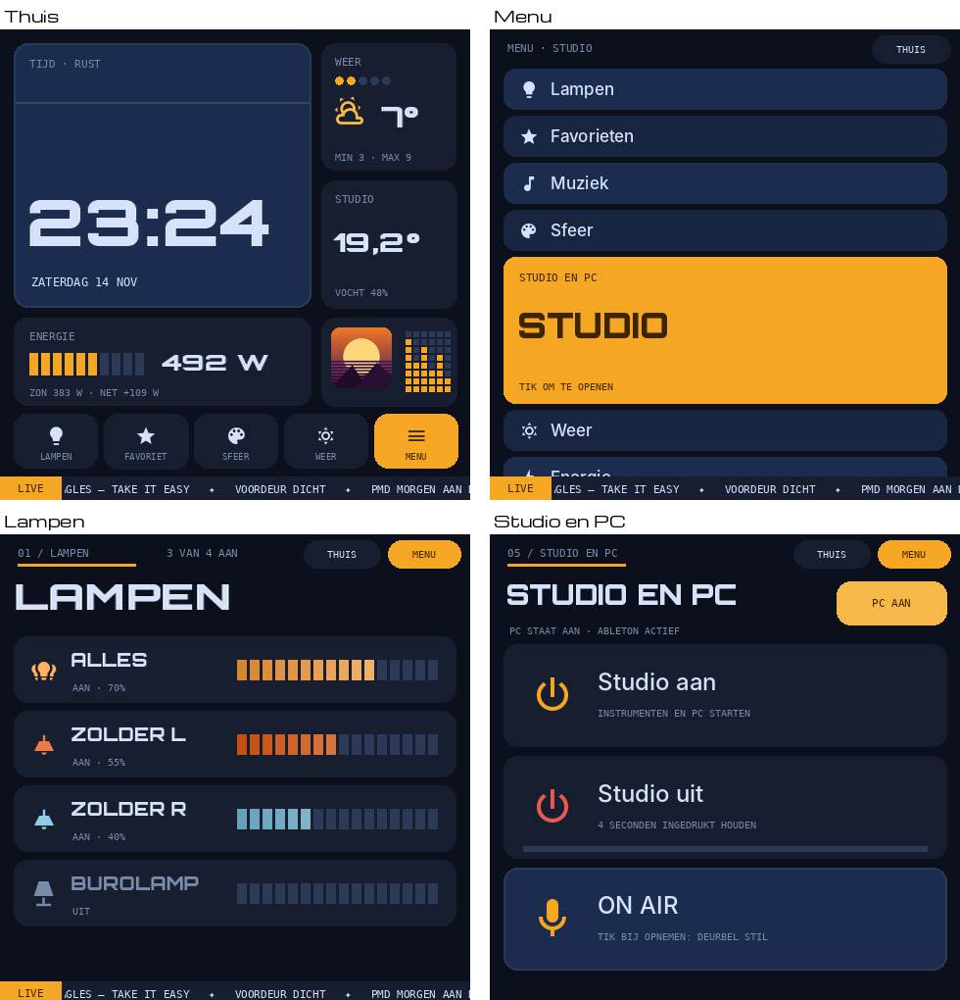
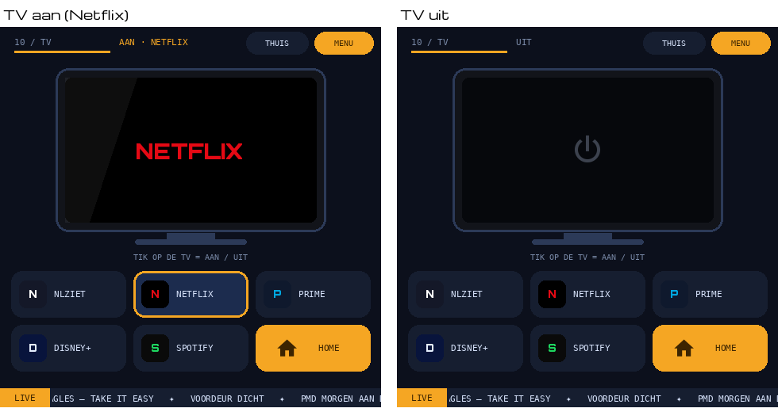
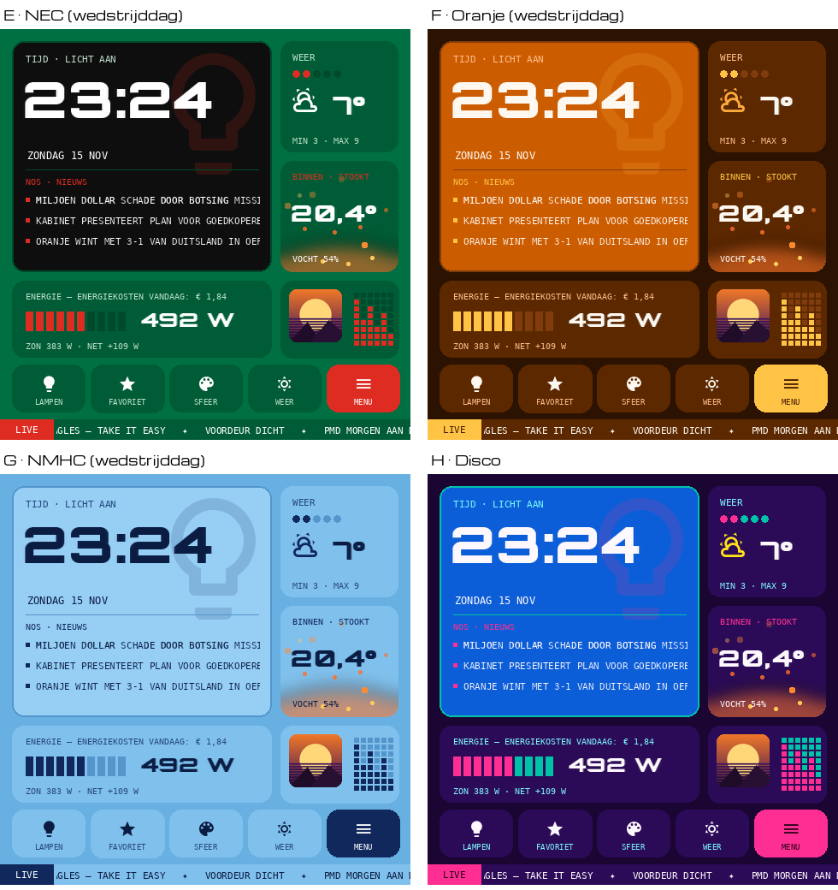

# ROBOBOOZ

Retro thema voor **Guition ESP32-S3-4848S040** (4", 480×480) touch displays met ESPHome + LVGL, gekoppeld aan Home Assistant en Music Assistant.

Ontwerp en idee: **Jeroen van Sonsbeek**

## Displays

| Bestand | Ruimte | Bijzonderheden |
|---|---|---|
| `display-woonkamer.yaml` | Woonkamer | TV-pagina, kachel-animatie, lampen woonkamer/keuken/eettafel |
| `display-studio.yaml` | Studio | ON AIR, PC-pagina, burolamp, Studio mini |

## Functies

- Thuisscherm met klok, datum en NOS-nieuws (3 regels), live ticker, weer, energie (incl. energiekosten vandaag) en nu-speelt met VU-meter
- Klik op de klok: alle lampen aan/uit
- Favorieten (radio links, playlists rechts, met albumart), Nu speelt-popup, wachtrij
- Lampen, Sfeer (scènes + Alles uit / Random kleuren), Klimaat, Huis, Energie, Schakelaars
- 8 thema's (A–D, NEC, Oranje, NMHC, Disco) met automatisch wedstrijdthema
- Dimmen: 1 min → 65 %, 2 min → 35 %, 30 min → nachtstand; eerste tik maakt alleen wakker

## Installeren

1. Zet de bestanden in je ESPHome-configmap (HA: `/config/esphome/`), inclusief de map `display/`.
2. Kopieer `secrets.example.yaml` naar `secrets.yaml` en vul je waarden in.
3. Zet in `display/` de afbeeldingen `oranje.jpg`, `vuur.gif` en `sneeuw.gif`.
4. Installeer via ESPHome Device Builder (draadloos). Bouw één display tegelijk: het compileren vraagt ~2,5 GB RAM.

### Nodig in Home Assistant

- `input_text.nieuws_display` + automatisering die de NOS-feed (feedreader) bijwerkt
- `input_select.display_thema` (A–H) en `input_text.display_thema_eigen_keuze`
- `script.lampen_random_kleuren`
- Optioneel: Team Tracker-sensoren voor NEC/Oranje en een agenda voor NMHC (automatisch wedstrijdthema)

## Screenshots

De afbeeldingen in `screenshots/` zijn ontwerp-mockups.

