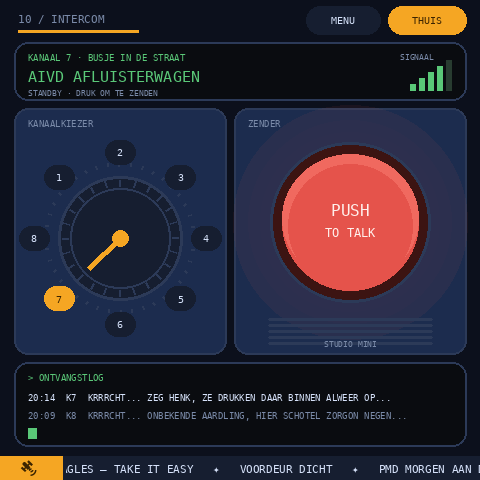

# ROBOBOOZ

Retro thema voor **Guition ESP32-S3-4848S040** (4", 480×480) touch displays met ESPHome + LVGL, gekoppeld aan Home Assistant en Music Assistant.

Ontwerp en idee: **Jeroen van Sonsbeek**

## Displays

| Bestand | Ruimte | Bijzonderheden |
|---|---|---|
| `display-woonkamer.yaml` | Woonkamer | TV-pagina, kachel-animatie, lampen woonkamer/keuken/eettafel, speler Yamaha woonkamer |
| `display-studio.yaml` | Studio | ON AIR, PC-pagina (Studio aan/uit), lampen studio/zolder/burolamp, speler Studio mini |

## Functies

- Thuisscherm met klok, datum en NOS-nieuws (3 regels), live ticker, weer, energie (incl. energiekosten vandaag) en nu-speelt met VU-meter
- Klik op de klok: alle lampen aan/uit
- Favorieten: alle favoriete radiozenders (links) en playlists (rechts) uit Music Assistant, meest gespeeld bovenaan, scrollbaar, met albumart en volumeslider van de eigen speler
- Nu speelt-popup en wachtrij
- Lampen, Sfeer (scènes + Alles uit / Random kleuren), Klimaat, Huis, Energie, Schakelaars
- 8 thema's (A–D, NEC, Oranje, NMHC, Disco) met automatisch wedstrijdthema
- Menu met kaarten, ook Nachtstand (dimme klok met sterren)
- Dimmen: 1 min → 65 %, 2 min → 35 %, 30 min → nachtstand; eerste tik maakt alleen wakker
- Automatische nachtstand tussen 23:00 en 06:00, behalve als er muziek speelt of er nog lampen aan zijn
- Beide displays: pagina Home Assistant (services als modules, CPU/geheugen/schijf-meters, temperatuur, 24-uursgrafiek, terminal)
- Woonkamer: pagina Plantenkas (4 planten; de pot is de vochtmeter, met status TOP / TE NAT / DORST, temperatuur en batterij)
- Studio: geheime Intercom naar parallelle universums (tik op het satellietblok in de LIVE-balk): kanaalkiezer met 8 kanalen, PUSH TO TALK, ruis + bericht via ElevenLabs als aankondiging op de studiospeaker (`script.intercom_zend`, `input_text.intercom_log`; geluiden in `www/robobooz/`)
- Radio: bij reclame ('Advert') een eigen hoes "Commercial Break" (zet `www/robobooz/` uit deze repo in `/config/www/robobooz/`)
- LIVE-ticker: AI-roast plus bijzonderheden van server (service uit, CPU heet/druk) en planten (dorst, te koud/warm, batterij bijna leeg)

## Installeren

1. Zet de bestanden in je ESPHome-configmap (HA: `/config/esphome/`), inclusief de mappen `display/` en `components/`.
   `components/robobooz_build` is een klein lokaal component dat een compileroptie aanzet; zonder die optie faalt het linken van deze grote configuratie (`l32r: literal target out of range`).
2. Kopieer `secrets.example.yaml` naar `secrets.yaml` en vul je waarden in.
3. De afbeeldingen in `display/` (`oranje.jpg`, `vuur.gif`, `sneeuw.gif`) staan al in deze repo.
4. Installeer via ESPHome Device Builder (draadloos). Bouw één display tegelijk: het compileren vraagt ~2,5 GB RAM.

### Nodig in Home Assistant

- `input_text.nieuws_display` + automatisering die de NOS-feed (feedreader) bijwerkt
- `input_select.display_thema` (A–H) en `input_text.display_thema_eigen_keuze`
- `script.lampen_random_kleuren`
- Music Assistant (app) op `http://<ha-ip>:8095` met API-token (`ma_api_token`); favorieten worden rechtstreeks uit Music Assistant gehaald
- Woonkamer: `input_text.server_info_display`, `input_text.server_hist_cpu`, `input_text.server_hist_temp` (automatiseringen *Displays - serverinfo* en *servergeschiedenis*) en System Monitor-sensoren
- Woonkamer: `input_text.planten_display` (automatisering *Displays - planten*)
- Optioneel: Team Tracker-sensoren voor NEC/Oranje en een agenda voor NMHC (automatisch wedstrijdthema)

## Screenshots

De afbeeldingen in `screenshots/` zijn ontwerp-mockups.

